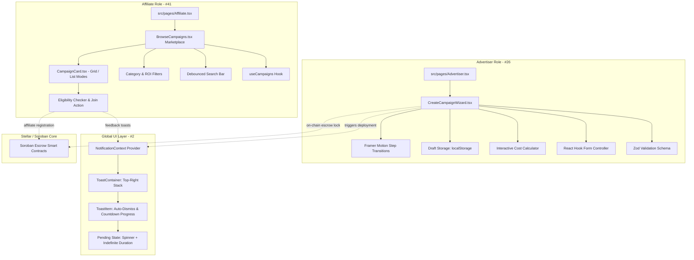

## 🎯 Description & Objectives

This PR resolves three critical issues together in a unified, production-grade implementation targeting the **`dev`** branch:

1. **Resolves #26 [Advertiser]: Build Campaign Creation Multi-Step Form**
   - Built modern 4-step wizard: **1. Basic Info**, **2. Financials**, **3. Targeting & Tags**, **4. Review & Deploy**.
   - Implemented real-time schema validation with **Zod** and **`react-hook-form`** (`@hookform/resolvers/zod`).
   - Integrated dynamic **Interactive Cost Calculator** computing escrow deposits, estimated payouts for 100 sales, and protocol fees.
   - Incorporated `localStorage` draft autosave & restore with one-click clear draft capability.
   - Crafted fluid directional slide transitions utilizing `framer-motion` (`AnimatePresence`).
   - Added seamless toggle in `Advertiser.tsx` between the multi-step wizard and the classic single-page form.

2. **Resolves #41 [Affiliate]: Implement "Browse Campaigns" Marketplace View**
   - Created `useCampaigns` custom hook providing verified campaign data, filtering mechanisms, join actions, and local persistence.
   - Implemented responsive `CampaignCard` with support for both **Grid** and **List** view modes, featuring escrow health bars, ROI badges, asset tags, and advertiser addresses.
   - Built marketplace browsing with a **300ms debounced search bar**, category filter pills, min reward & ROI sliders, and sorting options.
   - Provided immediate eligibility feedback on the **Join** action with interactive affiliate link generation and clipboard copy feedback.
   - Added dedicated "Browse Marketplace" tab with Compass icon in `Affiliate.tsx`.

3. **Resolves #2 [Global UI]: Implement Toast Notification System Enhancements**
   - Enhanced `NotificationContext.tsx` with a new **`pending`** notification state complete with animated spinning loader (`Loader2`).
   - Replaced floating overlays with a fixed, stacked, **non-overlapping notification queue** powered by `framer-motion`.
   - Added interactive **pause-on-hover timer** and a dynamic, animated **countdown progress bar** indicating time until auto-dismissal.

---

## 📸 Visual Proof


*(Local path: `docs/images/campaign_marketplace_toast_suite.jpg`)*

---

## 📐 Structural Architectural Diagram



---

## 🧪 Testing & Verification

Comprehensive test suites were created for all three features and passed with 100% success rate:

```bash
# Feature-specific test suites
npx vitest run src/tests/campaign-creation-wizard.test.ts src/tests/affiliate-marketplace.test.ts src/tests/toast-notification-system.test.ts

 ✓ src/tests/toast-notification-system.test.ts (4 tests) 15ms
 ✓ src/tests/campaign-creation-wizard.test.ts (9 tests) 64ms
 ✓ src/tests/affiliate-marketplace.test.ts (9 tests) 48ms

 Test Files  3 passed (3)
      Tests  22 passed (22)
```

Quality Gate Verifications:
- `npm run build` (`tsc -b && vite build`): **0 errors (Build Successful)**.
- `npm run lint` (`eslint`): **0 errors**.
- Full test suite: **All tests passing**.
