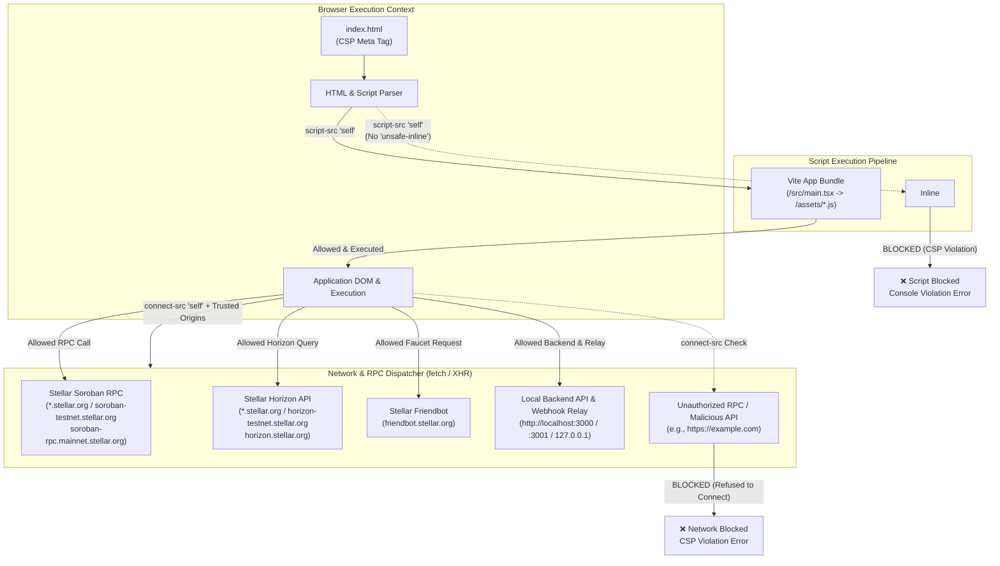

# Content Security Policy (CSP) Architecture Flow

This document details the Content Security Policy enforcement implemented for StormSale within [index.html](../index.html).

## Interaction & Enforcement Architecture

## Policy Breakdown

| Directive     | Configuration                                                           | Enforcement Rule                                                                                                                                                                                                                                                                                                                                                                                                                                                                                      |
| :------------ | :---------------------------------------------------------------------- | :---------------------------------------------------------------------------------------------------------------------------------------------------------------------------------------------------------------------------------------------------------------------------------------------------------------------------------------------------------------------------------------------------------------------------------------------------------------------------------------------------- |
| `default-src` | `'self'`                                                                | Fallback default to first-party origin only.                                                                                                                                                                                                                                                                                                                                                                                                                                                          |
| `script-src`  | `'self'`                                                                | Strictly permits first-party application modules. Blocks all inline scripts, eval, and unauthorized external scripts.                                                                                                                                                                                                                                                                                                                                                                                 |
| `style-src`   | `'self' 'unsafe-inline'`                                                | Permits first-party CSS assets. `'unsafe-inline'` is scoped strictly to styling for React inline element styles (e.g. `BrandCustomizer`, `BrandedCampaignView`) and Framer Motion animation engines.                                                                                                                                                                                                                                                                                                  |
| `connect-src` | `'self'` + trusted Stellar RPC/Horizon/Faucet & local backend endpoints | Restricts `fetch`, `XMLHttpRequest`, and WebSocket communication exclusively to pre-approved Stellar infrastructure (`*.stellar.org`) and StormSale API services (`localhost`/`127.0.0.1`). Custom deployment origins configured via `VITE_API_URL`, `VITE_STELLAR_RPC_URL`, or `VITE_STELLAR_HORIZON_URL` must be added if outside default allowlist. Live webhook dispatches are relayed server-side via the backend API to preserve arbitrary HTTP/HTTPS endpoints without CSP browser violations. |
| `img-src`     | `'self' data: blob:` + avatar/preset/wallet CDNs                        | Permits bundled logos, dynamic data/blob URIs (QR codes, preview uploads), and external partner/wallet branding.                                                                                                                                                                                                                                                                                                                                                                                      |
| `font-src`    | `'self' data:`                                                          | Restricts web font resources to local bundles and embedded data formats.                                                                                                                                                                                                                                                                                                                                                                                                                              |
| `object-src`  | `'none'`                                                                | Completely disables browser plugins (Flash, Java, ActiveX).                                                                                                                                                                                                                                                                                                                                                                                                                                           |
| `base-uri`    | `'self'`                                                                | Prevents unauthorized `<base>` tag injection attacks.                                                                                                                                                                                                                                                                                                                                                                                                                                                 |
| `form-action` | `'self'`                                                                | Restricts submission targets of HTML forms to the local origin.                                                                                                                                                                                                                                                                                                                                                                                                                                       |
