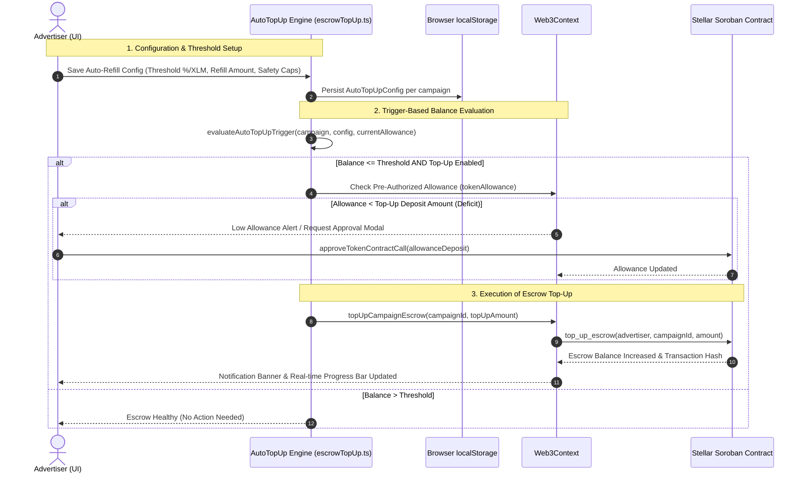

# Issue #107: Automated Escrow Top-Up Logic

## Architectural Diagram

## System Architecture Overview

1. **User-Defined Trigger Thresholds:**
   - Supports both `percentage` of max budget (e.g., refill when escrow drops below 10%–25%) and `fixed` token amounts (e.g., refill when balance drops below 500 XLM).
   - Allows setting configurable `topUpAmount` and daily refill limits (`maxTopUpsPerDay`).

2. **Pre-Authorized Allowance Handling:**
   - Inspects the advertiser's on-chain Soroban token allowance before triggering transactions.
   - If an allowance deficit exists (`allowance < topUpAmount`), the engine prevents failed transactions and prompts 1-click token pre-authorization via `approveTokenContractCall`.

3. **Autonomous Top-Up Execution:**
   - Invokes `top_up_escrow` on the Soroban escrow contract or local simulator.
   - Syncs real-time state with `Web3Context` and updates UI indicators, progress bars, and toast notifications.
