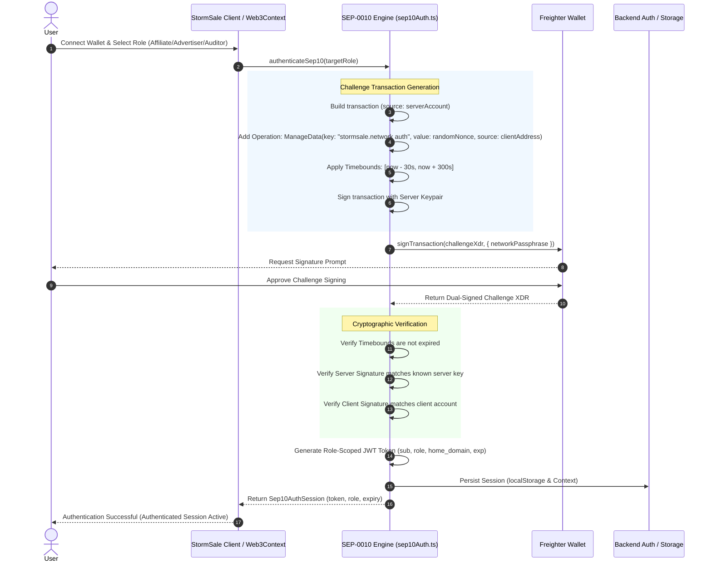

# Architecture: Stellar SEP-0010 Challenge-Response Authentication (#112)

## Overview

This document specifies the architectural implementation of **Stellar SEP-0010 (Stellar Web Authentication)** for StormSale. SEP-0010 provides a standard, cryptographically secure challenge-response authentication protocol enabling web clients (Freighter, Albedo, Passkeys, etc.) to prove ownership of a Stellar account and receive a role-scoped, verifiable JWT bearer token.

---

## High-Level Sequence Diagram

The following Mermaid sequence diagram visualizes the end-to-end authentication handshake between the StormSale client, Freighter wallet, challenge generator, and role-scoped session manager:

---

## Core Components

### 1. Challenge Transaction Builder (`buildSep10ChallengeTransaction`)
- Creates a valid Stellar transaction originating from the authoritative server account with sequence number `0`.
- Adds a `manageData` operation whose source is set to the client's public Stellar key and key is `<home_domain> auth`.
- Contains a cryptographically random 32-byte hexadecimal nonce.
- Sets strict time bounds (`300 seconds` validity window) to prevent replay attacks.
- Pre-signed by the server's Ed25519 keypair.

### 2. Dual-Signature Envelope Verification (`verifySep10SignedChallenge`)
- Decodes the signed transaction envelope using the configured Stellar network passphrase (`TESTNET` or `PUBLIC`).
- Verifies time bounds validity against the current system timestamp.
- Validates that the server signature is intact and valid over the transaction hash.
- Validates that the client's Ed25519 signature is present and cryptographically verified.

### 3. Role-Scoped JWT Issuance (`issueRoleScopedJwt`)
- Issues standard compact JWT tokens containing claims:
  - `sub`: Client Stellar public key (`G...`)
  - `role`: User role (`affiliate`, `advertiser`, `auditor`, `merchant`)
  - `home_domain`: Authenticating domain (`stormsale.network`)
  - `iss`: Authoritative server issuer
  - `iat`: Timestamp of issuance
  - `exp`: Token expiration time (default 24 hours)
- Signed using deterministic HMAC-SHA256 signature verification.

### 4. Web3 Context Integration (`Web3Context.tsx`)
- Exposes `sep10Session: Sep10AuthSession | null` and `authenticateSep10(roleOverride?: string)`.
- Updates `userRole` automatically upon successful authentication.
- Automatically clears session and purges local storage on `disconnectWallet()`.

---

## Security Invariants
1. **Replay Protection**: Challenge transactions enforce a 5-minute maximum time bound window and random nonces.
2. **Role Integrity**: Tokens bind the client address directly to the requested role and are checked on all role-gated endpoints.
3. **Session Revocation**: Local session credentials are fully wiped on wallet disconnect or key rotation.
