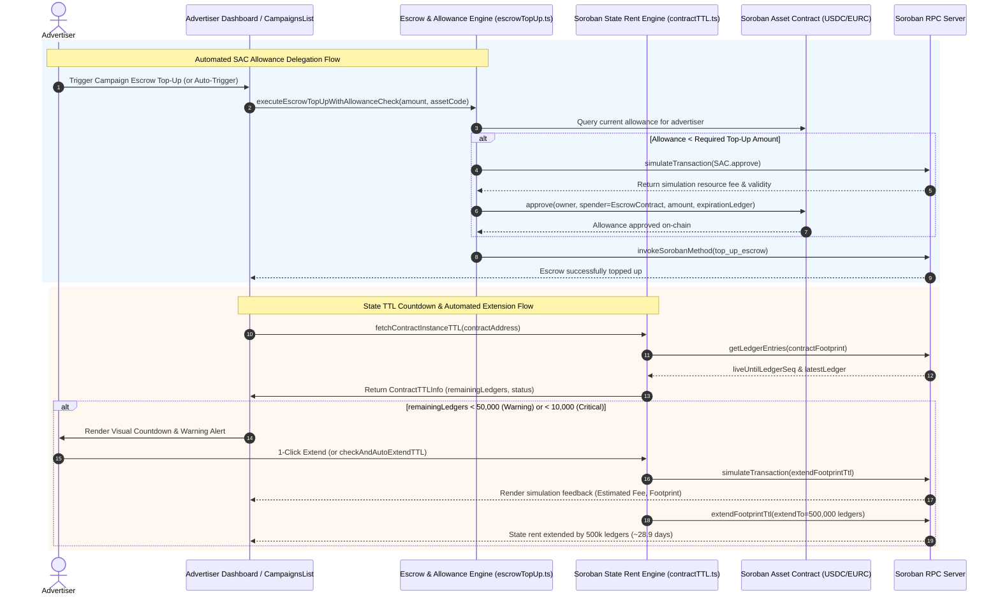

# Architecture: Automated SAC Token Allowance Delegation & TTL Extension (#119)

## Overview

This document specifies the architectural implementation of **Automated Soroban Asset Contract (SAC) Token Allowance Delegation & Storage TTL Extension** for StormSale. This ensures that advertiser USDC/EURC stablecoin escrows are never disrupted by exhausted token spending allowances or archived due to expiring state rent.

---

## Architectural Sequence Diagram

---

## Core Components

### 1. Automated SAC Token Allowance Delegation (`escrowTopUp.ts`)
- **Allowance Pre-Verification**: Evaluates `currentAllowance` against the requested top-up amount for native XLM and Circle SAC tokens (USDC, EURC).
- **Automated Delegation**: When a deficit exists and automated approval is permitted, invokes `approveTokenContractCall` for the deficit amount with Soroban simulation and sequence expiration offset.
- **Simulation Feedback**: Yields `simulationFeedback` metrics confirming resource fees and on-chain pre-conditions before executing `top_up_escrow`.

### 2. Soroban State Rent & TTL Engine (`contractTTL.ts`)
- **TTL Health Classifier**: Categorizes contracts into `healthy` (>= 50,000 ledgers), `warning` (< 50,000 ledgers), `critical` (< 10,000 ledgers), and `archived` (<= 0 ledgers).
- **Simulation Feedback (`simulateExtendContractTTL`)**: Runs non-mutating `simulateTransaction` on `Operation.extendFootprintTtl` to provide accurate resource fee estimates to the user.
- **Automated Extension Trigger (`checkAndAutoExtendTTL`)**: Evaluates storage TTL against `WARNING_TTL_THRESHOLD_LEDGERS` (50,000 ledgers) and automatically triggers an extension transaction if remaining lifetime is low.

### 3. UI Visual Health Indicator & Restorer (`ContractTTLRestorer.tsx` & `ContractTTLBadge.tsx`)
- Displays real-time ledger countdown and human-readable time remaining (e.g. `42,000 ledgers (~2d 10h)`).
- Renders an actionable warning banner whenever TTL dips below 50,000 ledgers.
- Provides 1-click extension controls (+100k, +250k, +500k ledgers) with live simulation feedback.
