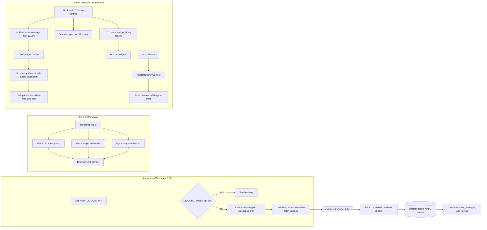
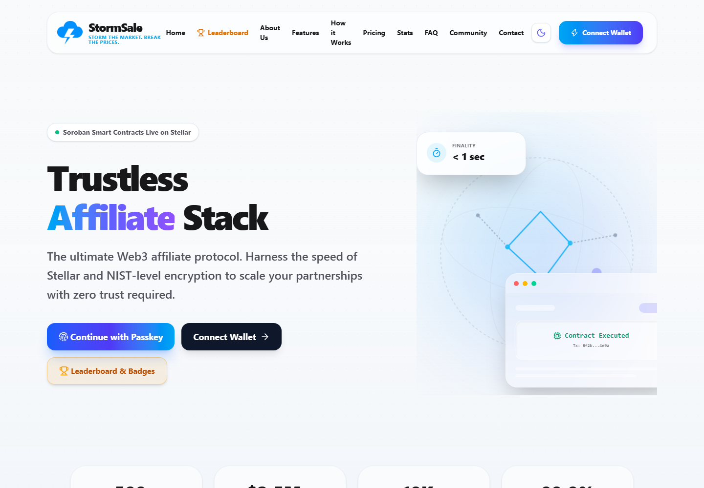
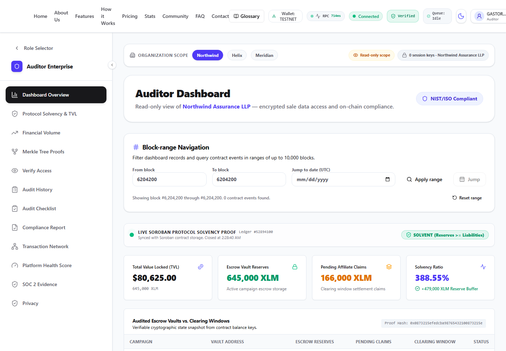
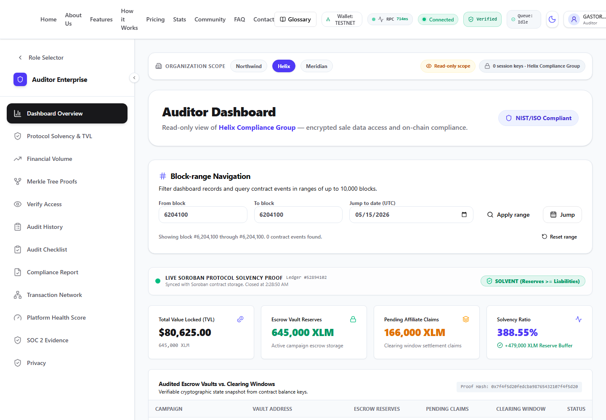
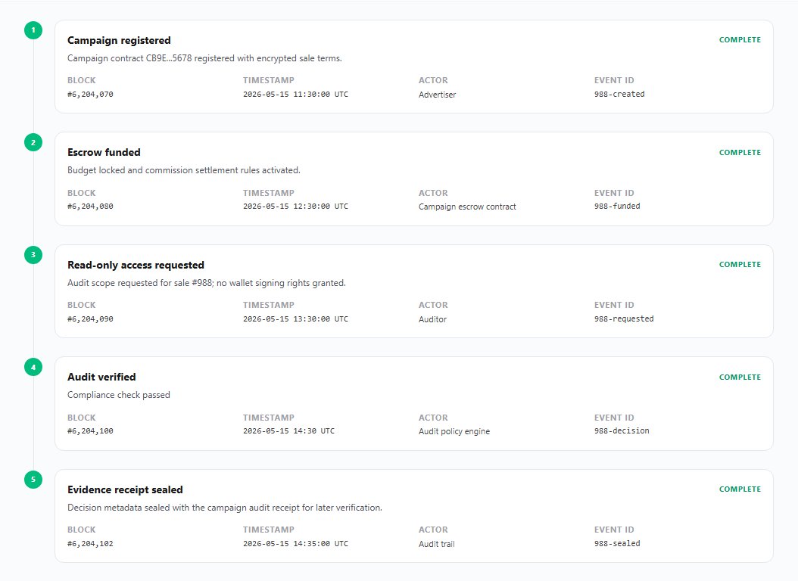

# Issues #210, #79, #63, and #62 — Architecture and Verification

## Architecture

## Visual evidence

### #79 — Strict CSP and network policy

Production Chromium verification confirmed:

- Telegram WebApp SDK loads with the updated SHA-384 SRI digest.
- Inline script elements and inline event handlers do not execute.
- React inline style attributes continue to work.
- A trusted Soroban RPC request succeeds.
- An untrusted RPC request is blocked by `connect-src`.
- Production localhost RPC/API attempts are blocked; localhost is allowed only in development.
- Fixed CoinGecko, Pyth Hermès, and Chainalysis origins remain available for existing pricing and sanctions features.
- Arbitrary federation servers, webhook destinations, custom RPC endpoints, merchant-hosted images, and deployment-specific Sentry ingestion hosts are intentionally blocked. Those features require a first-party proxy or an explicitly reviewed origin before they can be enabled under the strict policy.

### #63 — Block-range navigation and search

The date-jump screenshot uses deterministic Horizon and Soroban responses in Chromium so the binary-search result is reproducible. Automated tests also cover invalid dates, future dates, bounded chunking, cursor pagination, deduplication, stale-response protection, and RPC failure fallback.

### #62 — Interactive audit trail timeline

Each expanded lifecycle exposes the block, UTC timestamp, actor, event ID, status, and detail for every step. Verified campaigns seal an evidence receipt; denied campaigns show a denied decision; pending campaigns remain at the current decision step. Records remain scoped to the selected auditor organization.
