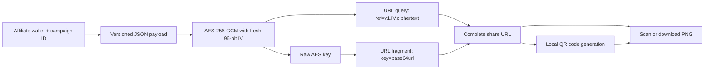
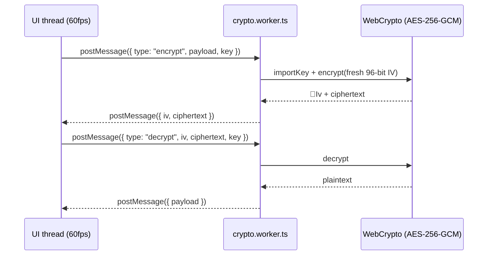

# Issue #46: encrypted affiliate link flow

The encrypted payload contains `{ v, affiliate, campaignId, createdAt }`. The query can be sent to the destination server without revealing the affiliate details. Browsers do not send URL fragments in HTTP requests, so the decryption key remains client-side. Anyone with the complete share URL can read the payload; the encryption protects metadata in transit and in server-visible request data, not access from recipients.

## Background crypto worker (Issue #46)

AES tasks are offloaded to a non-blocking background thread so the UI remains at 60fps during audits and encrypted message bridge operations.

The worker communicates only via structured clone messages (`postMessage`), so the main thread never blocks on WebCrypto AES operations. The encrypted message bridge passes the versioned payload and raw key into the worker and returns the IV + ciphertext for the URL query and the base64url key for the URL fragment.

> **CI note (PR #325):** The malware/supply-chain guard flagged `actions/checkout` inside a `pull_request_target` workflow, where fork PR code must not be checked out and executed in the trusted base-repository context (`allow-unsafe-pr-checkout` stays `false`). Resolution: the `pull_request_target` job is limited to metadata only and never fetches or runs fork code. Untrusted code is checked out and tested only from a `pull_request` trigger, which runs without base-repository secrets. `allow-unsafe-pr-checkout: true` is not used.