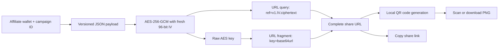

# Issue #46: encrypted affiliate link flow

The encrypted payload contains `{ v, affiliate, campaignId, createdAt }`. The query can be sent to the destination server without revealing the affiliate details. Browsers do not send URL fragments in HTTP requests, so the decryption key remains client-side. Anyone with the complete share URL can read the payload; the encryption protects metadata in transit and in server-visible request data, not access from recipients.
