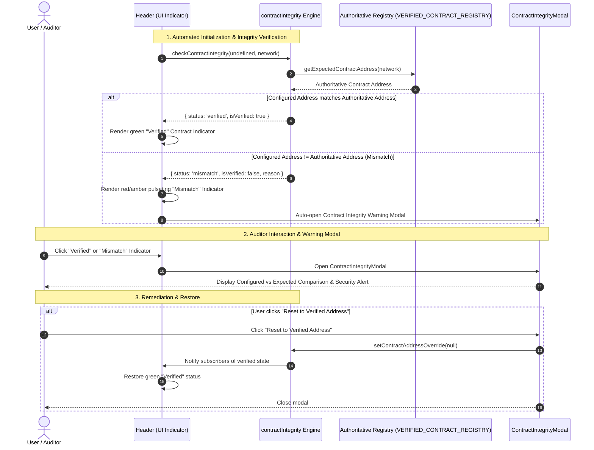
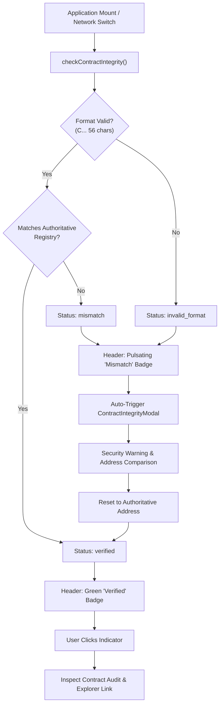

# Issue #65: Contract Integrity Verification UI Architecture

## 1. Sequence Diagram

## 2. Component Flowchart

## 3. System Architecture & Safety Guarantees

1. **Automated Verification Guard:**
   - Evaluates active runtime contract addresses against authoritative hardcoded constants (`VERIFIED_CONTRACT_REGISTRY`) per network (`TESTNET`, `PUBLIC`).
   - Ensures strict 56-character RFC 4648 Base32 contract key validation (`C...`).

2. **Visual Feedback in Header:**
   - **Verified State:** Sleek, unobtrusive emerald pill with `ShieldCheck` icon, displaying `"Verified"` and verified address tooltip.
   - **Mismatch State:** High-visibility rose pulsating badge with `ShieldAlert` icon, displaying `"Mismatch"` to immediately flag potential address spoofing or rogue escrow deployments.

3. **Interactive Warning Modal:**
   - Displays side-by-side comparison between the runtime configured address and the authoritative registry.
   - Provides 1-click clipboard copy for both addresses and direct deep-linking to the Stellar Expert block explorer.
   - Includes a 1-click `"Reset to Verified Address"` action to instantly restore the authoritative contract address.
