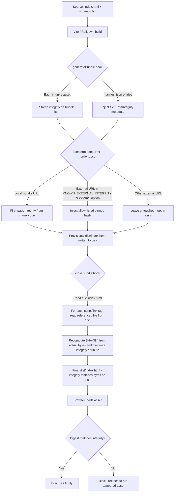

# Issue #85 — Subresource Integrity (SRI) Build

**Target page:** [`vite.config.ts`](../vite.config.ts) (build configuration wiring)
**Plugin source:** [`src/lib/vite/subresource-integrity-plugin.ts`](../src/lib/vite/subresource-integrity-plugin.ts)
**Test coverage:** [`src/tests/subresource-integrity.test.ts`](../src/tests/subresource-integrity.test.ts)

The plugin implementation was extracted from `vite.config.ts` into
`src/lib/vite/subresource-integrity-plugin.ts` so Vitest's
`coverage.include: ["src/**/*.{ts,tsx}"]` glob measures it directly and the
CI PR coverage gate stays above the 80% diff threshold. `vite.config.ts`
re-exports `computeIntegrity`, `subresourceIntegrity`, and
`KNOWN_EXTERNAL_INTEGRITY` so existing imports keep resolving.

## Goal

Every asset a browser loads from a StormSale build must be cryptographically
verified before execution. If a CDN, an OSS bucket, a mirror or a man-in-the-middle
path is compromised, the tampered bytes fail the browser's `integrity` check and
the resource is refused — no code executes.

The plugin delivers two Acceptance Criteria:

1. **Automatic build-time hash generation** — Rolldown (Vite 8) can finalise
   chunk bytes *after* `transformIndexHtml`, so the plugin performs the
   authoritative pass in `closeBundle`: it reads `dist/index.html`, walks every
   `<script>` and `<link>` tag, hashes the corresponding file from disk
   (SHA-384) and rewrites the `integrity="sha384-…"` attribute to match. The
   earlier `transformIndexHtml` and `generateBundle` hooks still run so the
   emitted bundle entries and `manifest.json` carry integrity metadata for
   programmatic consumers, but the HTML tag values that reach the browser are
   always the disk-derived ones. Every rewritten tag also carries
   `crossorigin="anonymous"`, which the browser requires to run the check.
2. **Hash verification on script load** — the `integrity` attribute is the
   verification directive; the browser performs the digest and blocks execution
   on mismatch. External `<script src="https://…">` tags are pinned only when
   their exact URL appears in `KNOWN_EXTERNAL_INTEGRITY` or in the caller's
   `external` option; un-listed URLs are left untouched.

## Architecture



## Data flow inside `src/lib/vite/subresource-integrity-plugin.ts`

| Layer | Responsibility | Symbol |
| --- | --- | --- |
| Hash primitive | Turns bytes into `sha384-…` (or user-selected algorithms) | `computeIntegrity()` |
| Pinned third-parties | Static map of CDN URL → reviewed hash | `KNOWN_EXTERNAL_INTEGRITY` |
| Bundle resolver | Finds the emitted chunk/asset for a local URL, honouring `config.base` | `resolveIntegrity()` |
| Attribute weaver | Adds `integrity`/`crossorigin` without clobbering existing attributes | `applyIntegrityAttrs()` |
| Vite plugin | Registers `generateBundle` + `transformIndexHtml` hooks, applies only on production builds | `subresourceIntegrity()` |

## Behaviour contract

* **`apply: "build"`** — no impact on the dev server. Hashing only runs during
  `vite build`.
* **`enforce: "post"`** — runs *after* the standard HTML injection so it sees
  the final bundle URLs (hashed filenames such as `assets/index-DxY2.js`).
* **Idempotent** — existing `integrity` / `crossorigin` attributes are never
  duplicated by `transformIndexHtml`; `closeBundle` overwrites `integrity`
  values (that's the whole point) but preserves every other attribute including
  `data-integrity`.
* **Disk-authoritative** — `closeBundle` reads each local asset from disk and
  recomputes the digest so the emitted `integrity` value always matches the
  bytes the browser will fetch. This is what prevents the Rolldown
  `chunk.code` ≠ on-disk-file mismatch that caused the Playwright e2e run in
  PR #85 to fail with `Failed to find a valid digest in the 'integrity' attribute`.
* **Conservative on externals** — third-party URLs are only touched when they
  appear in `KNOWN_EXTERNAL_INTEGRITY` or the caller passes `external: { url: hash }`.
  Unknown protocol-relative or absolute URLs are passed through unchanged.
  `KNOWN_EXTERNAL_INTEGRITY` ships empty because hosts like `telegram.org`
  serve different bytes per request (accept-encoding, referer, sec-fetch-*),
  making build-host-computed hashes unreliable.

## Adding a new external script

1. Fetch the file from the upstream origin:
   ```bash
   curl -sSL https://cdn.example.com/lib.js | openssl dgst -sha384 -binary | openssl base64 -A
   ```
2. Add the pair to `KNOWN_EXTERNAL_INTEGRITY` in
   `src/lib/vite/subresource-integrity-plugin.ts` (or pass it via
   `subresourceIntegrity({ external: { … } })` at the call site in
   `vite.config.ts`).
3. Run `npm run build` and inspect `dist/index.html` — the tag should now carry
   `integrity="sha384-…" crossorigin="anonymous"`.
4. Load the built app and confirm the browser console shows no
   `Failed to find a valid digest in the 'integrity' attribute` error.

## Verification / visual proof checklist

For the PR reviewer:

* Run `npm run build`.
* Open `dist/index.html` — every `<script type="module" crossorigin src="/assets/…">`
  and `<link rel="stylesheet" crossorigin href="/assets/…">` tag must contain
  an `integrity="sha384-…"` attribute; the `https://telegram.org/js/telegram-web-app.js`
  script tag must be pinned.
* Serve `dist/` and open DevTools → Network tab, tick "Disable cache".
* Tamper with any file under `dist/assets/` (add a byte) and reload — the browser
  must refuse to execute it (red console error) and the app must not boot.
* Restore the file and reload — the app boots normally with a green Network tab.

Take a screenshot of the tamper attempt (console error + blocked resource) and
attach it to the PR — this satisfies the "📸 Visual Proof" requirement.
