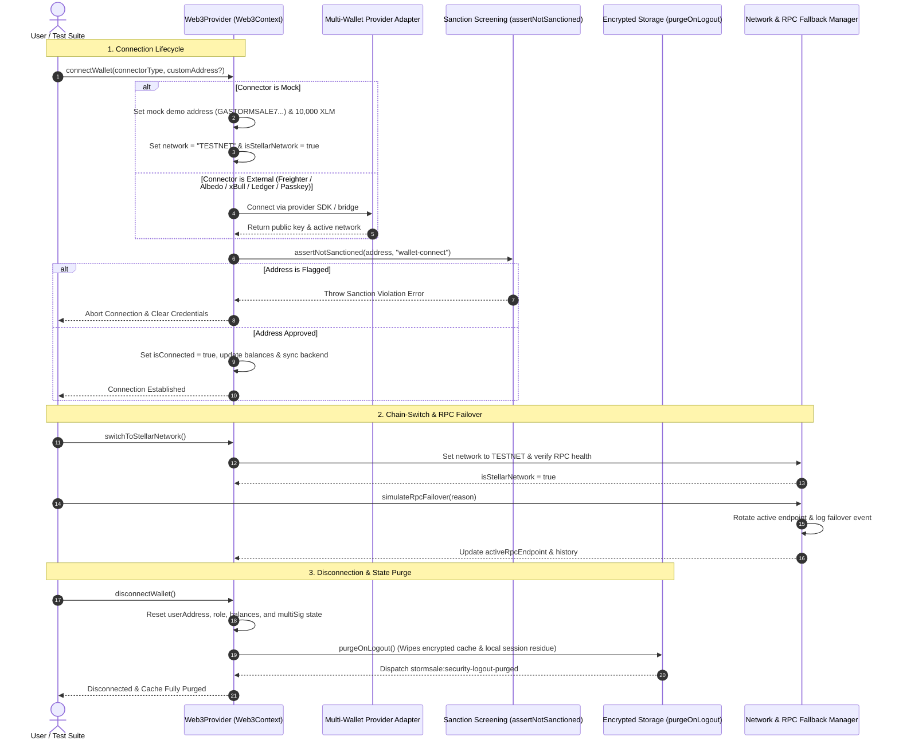
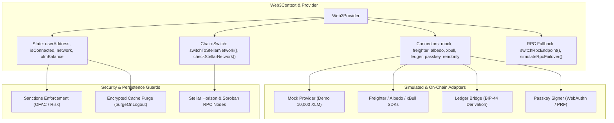

# Issue #89: Mock Web3 Connection Logic & Chain-Switch Architecture

## 1. Architectural Diagram

## 2. Component Structure Overview

## 3. System Architecture & Testing Coverage

1. **Mock Connection & Zero-Dependency Simulation:**
   - Provides deterministic testnet demo accounts (`GASTORMSALE7TESTNET7AFFILIATE7MERCHANT7ESCROW7XLM77777`) initialized with 10,000 XLM for instantaneous integration testing without live testnet faucet rate limits.
   - Allows testing of simulated token allowance approval (`approveTokenAllowance`) and escrow top-ups in isolated sandbox environments.

2. **Full Multi-Wallet Connector Coverage:**
   - Covers all supported wallet connector modes (`freighter`, `albedo`, `xbull`, `ledger`, `passkey`, `readonly`, `mock`).
   - Simulates hardware Ledger BIP derivation path modifications (`44'/148'/0'`).
   - Validates proper exception handling when extensions are absent or addresses are missing/sanctioned.

3. **Chain-Switch Logic & Network Validation:**
   - Evaluates `isStellarNetwork` against `TESTNET` and `PUBLIC` network identifiers.
   - Provides `switchToStellarNetwork()` to return the frontend to the correct target network.
   - Tests Horizon connectivity checks and explorer deep-linking utilities.

4. **Resilient RPC Failover:**
   - Verifies seamless failover transitions between primary Soroban RPC endpoints, backup enterprise nodes, and custom developer endpoints.
   - Confirms real-time event recording in `rpcFailoverHistory`.

5. **Security Logout & Storage Purge:**
   - Guarantees that `disconnectWallet()` wipes active connection context, nullifies multisig authorizations, and invokes `purgeOnLogout()` to eliminate encrypted local cache residue.
