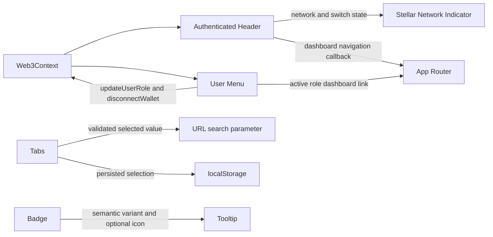

# UI Management Architecture

The header and account menu read wallet state directly from `Web3Context`. Role changes use the existing role update API, navigation is delegated to the app router, and tab state is restored from a validated URL value or local preference.
