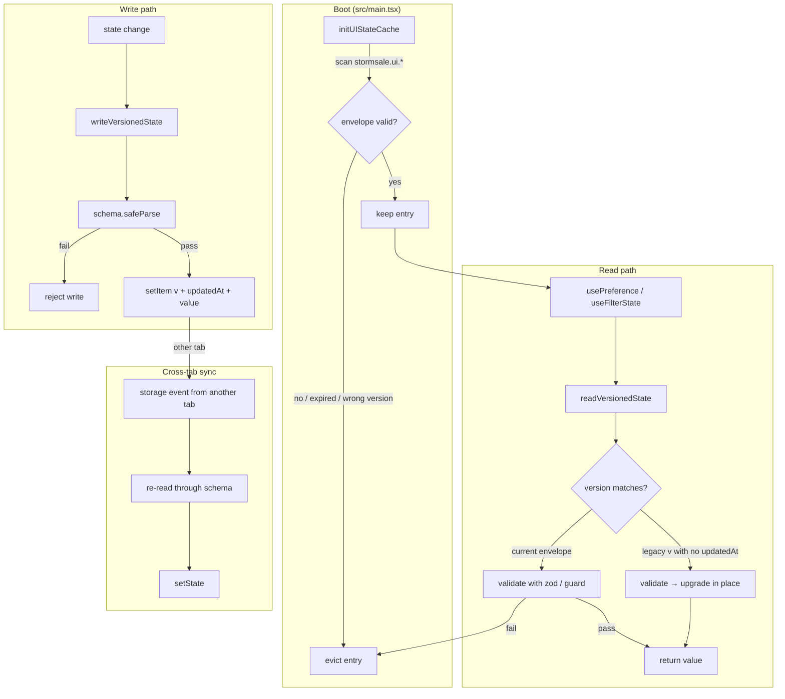

# Persistent UI & Filter State Cache — Architecture

## Overview

Dashboard preferences (active tab, nav state, theme) and structured filter
state (search, status, timeframe, sort) persist in `localStorage` under one
versioned, schema-validated contract:

```json
{ "v": 1, "updatedAt": 1750000000000, "value": { "...": "..." } }
```

A corrupt, outdated, off-schema, or expired entry is evicted instead of being
rendered. Both hooks share the same low-level envelope helpers in
`src/lib/uiStateCache.ts`.

## Data flow



## Guarantees

| Aspect               | Implementation                                                                |
| -------------------- | ----------------------------------------------------------------------------- |
| Schema safety        | Reads and writes validate against a `zod` schema (filters) or guard (prefs).  |
| Versioning           | `UI_STATE_VERSION = 1`; any other version is purged on read and at boot.      |
| Legacy migration     | `{ v, value }` preference entries gain `updatedAt` on first read.             |
| TTL expiration       | Filters older than 30 days are dropped at boot; preference keys never expire. |
| Cross-tab sync       | A `storage` listener rehydrates changes from other tabs, re-validating first. |
| Write de-duplication | Hooks skip writes when the serialized value is unchanged, preventing echoes.  |
| SSR / private mode   | `getSafeStorage()` returns `null` without a DOM; defaults always apply.       |
| Boot hygiene         | `initUIStateCache()` purges stale entries before the first React render.      |

## Keys

| Layer       | Storage key                   | Envelope                  |
| ----------- | ----------------------------- | ------------------------- |
| Preferences | `stormsale.<scope>.<name>`    | `{ v, updatedAt, value }` |
| Filters     | `stormsale.ui.<scope>.<name>` | `{ v, updatedAt, value }` |

Both namespaces use the same version and validation pipeline; only the key
prefix differs so filters can be swept at boot without touching unrelated
application storage.
