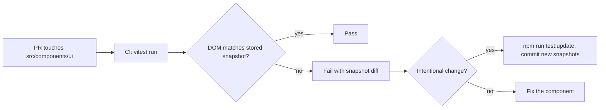
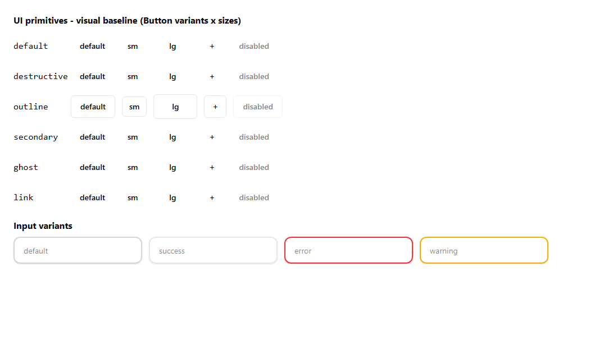
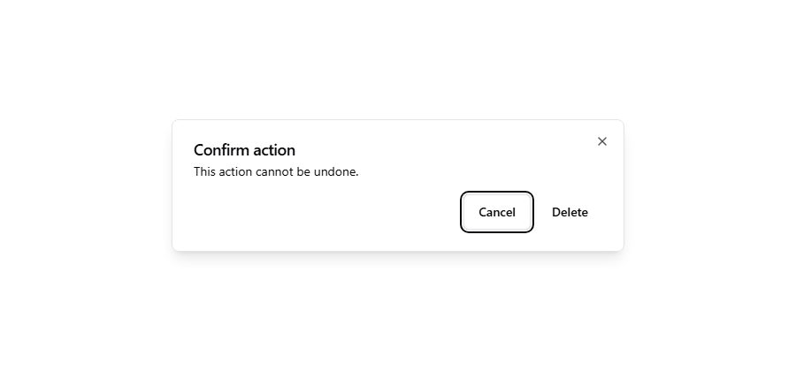

# UI primitive visual baselines

Snapshot tests for every primitive in `src/components/ui/` (Button, Dialog, Card, Input, Label,
InputField/InputGroup, Table). Each snapshot stores the rendered DOM, including the Tailwind class
list, so any change to a variant's appearance shows up as a diff.

## Coverage

| Component                      | Cases                                                                                 |
| :----------------------------- | :------------------------------------------------------------------------------------ |
| Button                         | 6 variants x 4 sizes, 6 disabled states, default props, custom `className`, `asChild` |
| Dialog (modal)                 | title only, header + description + body + footer, custom `className`, closed          |
| Input                          | `default` / `success` / `error` / `warning`, disabled                                 |
| Card, Label, InputField, Table | composed and customised states                                                        |

## How CI uses them

When `CI=true` (GitHub Actions) Vitest never writes new snapshots, so a missing or changed snapshot
fails the build instead of being silently accepted.

## Commands

- `npm test` runs all tests, including these.
- `npm run test:update` regenerates snapshots after an intentional visual change. Review the
  `__snapshots__` diff before committing.

Generated ids (`«r1»`, `radix-...`) are normalised in `snapshot-utils.ts` so snapshots stay stable.

## Visual proof

Rendered primitives (Button variants x sizes, Input variants) and the modal, captured from the real components:

