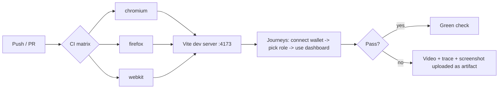
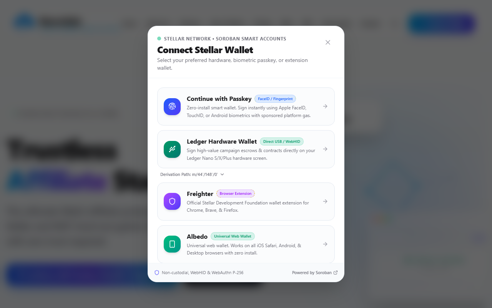
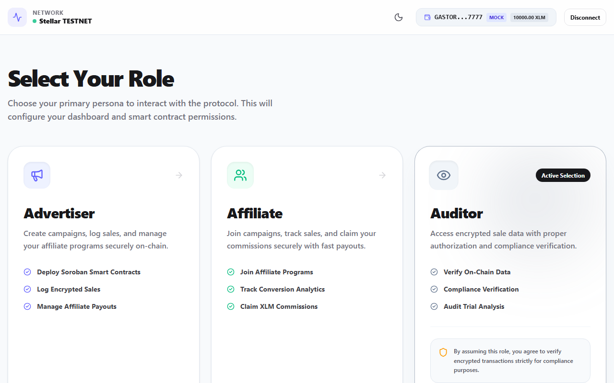
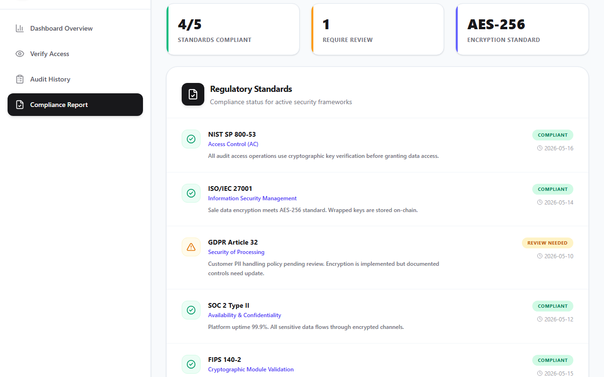

# End-to-end user journeys

Playwright tests that drive the real app (Vite dev server) through full user journeys.

| Spec                       | Journeys                                                                                               |
| :------------------------- | :----------------------------------------------------------------------------------------------------- |
| `wallet-connection.e2e.ts` | open/close wallet modal, demo account connect + disconnect, read-only key validation (reject + accept) |
| `role-journeys.e2e.ts`     | role consent + cancel, advertiser / affiliate / auditor dashboards, return to role selector            |

## Acceptance criteria

- **Multi-browser:** `chromium`, `firefox` and `webkit` projects (`playwright.config.ts`); CI runs one matrix job per browser (`.github/workflows/e2e.yml`).
- **Video on failure:** `video: "retain-on-failure"` (plus screenshot and trace). Failed runs upload `test-results/e2e/` and `playwright-report/` as a CI artifact.



## Running locally

```bash
npm run test:e2e:install   # one-off browser download
npm run test:e2e           # all browsers
npx playwright test --project=firefox
npx playwright show-report
```

The backend and Horizon are stubbed (`mockBackend` in `helpers.ts`), so the journeys need no API or network. Wallets that need an extension or hardware (Freighter, Ledger, passkey) are not driven; the 1-tap demo account and read-only mode cover the connect flow.

## Visual proof

Journey captured in a real browser: wallet modal, role selection with consent, auditor dashboard.




