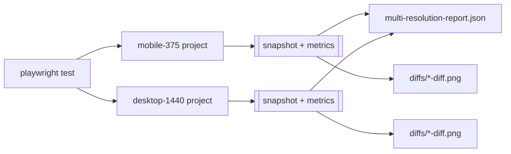

# Multi-Resolution Visual Regression

Pixel-level visual regression tests that capture the app at **375px (mobile)** and **1440px (desktop)** and generate automated diff artifacts when a UI break is detected.

## What it covers

- Routes defined in `tests/e2e/visual-regression.spec.ts` (`ROUTES`) are visited at both viewports.
- Each route is asserted for horizontal overflow (`overflowX <= 1`x) so broken layouts fail fast.
- Playwright `snapshotPath` captures and compares screenshots per viewport.
- A cross-viewport JSON report is written to `test-results/visual-regression/multi-resolution-report.json`.

## Viewports

| Name      | Width | Height | Notes                  |
| --------- | ----- | ------ | ----------------------- |
| mobile    | 375  | 812    | touch enabled, deviceScale 1- |
| desktop   | 1440 | 900    | desktop chrome           |

## Artifacts

All artifacts are written under `test-results/visual-regression/`:

- `tests/e2e/__snapshots__/<viewport>-<route>.png` — baseline snapshots (committed).
- `diffs/<viewport>-<route>-diff.png` — Playwright diff image generated on failure.
- `diffs/<viewport>-<route>-metrics.json` — layout metrics (viewport width, document width, overflow, scroll height).
- `multi-resolution-report.json` — combined report across both viewports.

## Running locally

The dev server must be running before the visual tests execute.

```bash
npm run dev &  # serves on http://localhost:4173

npx playwright test --config tests/e2e/visual-regression.config.ts
```

Override the target with `VISUAL_REGRESSION_BASE_URL`:

```bash
VISUAL_REGRESSION_BASE_URL=http://localhost:5173 npx playwright test --config tests/e2e/visual-regression.config.ts

```

## Updating baselines

When a UI change is intentional, regenerate the baseline snapshots and commit them:

```bash
npx playwright test --config tests/e2e/visual-regression.config.ts --update-snapshots
```

## Adding a route

Add an entry to `ROUTES` in `tests/e2e/visual-regression.spec.ts`. The spec automatically generates mobile and desktop cases for every route.

## Architecture


